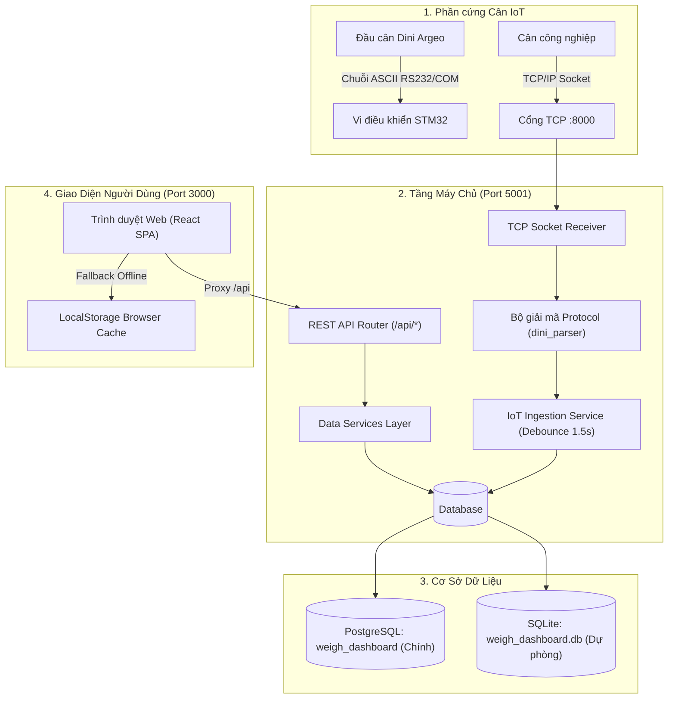

# TÀI LIỆU DÀNH CHO LẬP TRÌNH VIÊN (DEVELOPER ONBOARDING GUIDE)
> **Dự án:** Phan Bach Weigh Dashboard (Hệ thống giám sát trạm cân & quản lý sản xuất thời gian thực)  
> **Mục đích:** Giúp lập trình viên mới nắm bắt toàn bộ luồng nghiệp vụ, kiến trúc code và phát triển tính năng mới nhanh chóng mà **không cần phải đọc lại từng dòng source code**.

---

## 1. BỐI CẢNH NGHIỆP VỤ & QUY TẮC BẮT BUỘC (DOMAIN RULES)

Hệ thống được thiết kế riêng cho **nhà máy chế biến thủy sản (chủ lực là tôm) của Phan Bách**. Nếu bạn chưa từng làm việc với ngành thủy sản, hãy đọc kỹ các quy tắc cốt lõi sau để tránh viết sai thuật toán:

### 1.1. Luồng 15 công đoạn sản xuất
Hàng hóa đi qua các bước từ `CD001` đến `CD015`:
1. `CD001`: Tiếp nhận nguyên liệu ban đầu.
2. `CD002` → `CD004`: Phân cỡ, rửa, sơ chế bóc vỏ / rút chỉ.
3. `CD005`: Ngâm quay (ngâm nước + phụ gia).
4. `CD006` → `CD011`: Cân chia mẻ, tẩm bột, hấp/luộc, tách vỏ.
5. `CD012` → `CD015`: Cấp đông IQF, đóng gói, thành phẩm xuất xưởng.

### 1.2. Quy tắc cân bằng khối lượng (RẤT QUAN TRỌNG)
- **Đầu ra có thể LỚN HƠN đầu vào:** Tại công đoạn **Ngâm quay (`CD005`)** hoặc **Tẩm bột (`CD007`)**, tôm ngấm nước/phụ gia nên đầu ra sẽ nặng hơn đầu vào (ví dụ: vào 100 kg → ra 105 kg).
- **Đầu ra NHỎ HƠN đầu vào:** Tại các bước **Bóc vỏ (`CD004`)**, **Tách vỏ (`CD011`)**, tôm bị bỏ đầu và vỏ nên đầu ra ít hơn đầu vào (ví dụ: vào 100 kg tôm nguyên con → ra 60 kg tôm thịt).
- **Cách tính WIP (Hàng đọng trên chuyền):**
  > ❌ **TUYỆT ĐỐI KHÔNG** tính: `WIP = Tổng IN toàn nhà máy - Tổng OUT toàn nhà máy`.  
  > Cách tính này hoàn toàn sai vì bước ngâm quay sẽ làm số liệu bù trừ triệt tiêu lẫn nhau.
  >
  > ✅ **LUÔN PHẢI TÍNH:** Tính WIP độc lập tại từng công đoạn:  
  > `WIP tại công đoạn = Số kg đã vào - Số kg đã ra (sau khi trừ hao hụt chuẩn nếu có)`.  
  > `Tổng WIP toàn xưởng = Tổng các giá trị WIP dương của từng máy cộng lại`.

### 1.3. Phong cách giao diện & Ngôn từ
- **Dùng từ ngữ dân dã, thực tế nhà xưởng:** Quản lý xưởng và công nhân thích từ dễ hiểu như: *Vào, Ra, Đang đọng, Chưa làm, Chênh lệch, Công đoạn, Lô hàng*.
- **Tránh từ ngữ đao to búa lớn/học thuật:** Không dùng các từ như *"tăng trọng"*, *"dòng chảy"*, *"biến thiên"*, *"ma trận"* trên giao diện người dùng.

---

## 2. KIẾN TRÚC TỔNG THỂ (SYSTEM ARCHITECTURE)



### 2.1. Hai bộ máy chủ Backend tương thích 100%
Dự án được viết sẵn **cả 2 phiên bản Backend**, dùng cái nào cũng chạy hoàn toàn tương thích với Frontend:
1. **Node.js / Express Backend (Mặc định cho máy xưởng):**
   - File chạy: `backend/node/dist/server.cjs` (biên dịch từ `backend/node/src/server.ts`).
   - Có tích hợp sẵn **TCP Socket Server** trên cổng `8000` để nhận trực tiếp tín hiệu từ phần cứng cân STM32.
2. **Python Flask Backend (Dành cho PythonAnywhere / Server Python):**
   - File chạy: `backend/app.py`.
   - Kết nối linh hoạt qua SQLite hoặc PostgreSQL thông qua biến môi trường `DATABASE_URL`.

---

## 3. BẢN ĐỒ MÃ NGUỒN (CODEBASE MAP - ĐIỂM ĐẾN NHANH)

Nếu bạn cần sửa tính năng hoặc giao diện, hãy đến thẳng các file sau:

### 3.1. Frontend (`src/`)

| File / Thư mục | Trách nhiệm | Khi nào cần sửa file này? |
| :--- | :--- | :--- |
| [`src/pages/OverviewPage.tsx`](file:///Users/phanbach/Desktop/TheBaoUser/PhanBachWork/website/weigh_dashboard/webDesignUI/src/pages/OverviewPage.tsx) | **Trang Tổng Quan Sản Xuất** | Điều chỉnh bố cục trang chính, luồng kết nối giữa các khối điều khiển. |
| [`src/components/overview/ProductionKPICards.tsx`](file:///Users/phanbach/Desktop/TheBaoUser/PhanBachWork/website/weigh_dashboard/webDesignUI/src/components/overview/ProductionKPICards.tsx) | **4 Thẻ số lớn (KPI)** | Thay đổi cách hiển thị 4 con số: Nguyên liệu vào, Thành phẩm ra, Đọng trên chuyền, Còn chưa làm. |
| [`src/components/overview/BatchProductionHub.tsx`](file:///Users/phanbach/Desktop/TheBaoUser/PhanBachWork/website/weigh_dashboard/webDesignUI/src/components/overview/BatchProductionHub.tsx) | **Bảng Quản lý các Lô hàng** | Thay đổi các tab (Làm hôm nay, Đang làm, Đã xong), thanh % tiến độ mini, hoặc nút thao tác nhanh trên từng lô. |
| [`src/components/overview/VisualPipelineFlow.tsx`](file:///Users/phanbach/Desktop/TheBaoUser/PhanBachWork/website/weigh_dashboard/webDesignUI/src/components/overview/VisualPipelineFlow.tsx) | **Bảng Chi tiết 15 công đoạn** | Thay đổi accordion hiển thị khối lượng Vào/Ra/Đọng của từng công đoạn từ CD001 đến CD015. |
| [`src/components/overview/BatchModal.tsx`](file:///Users/phanbach/Desktop/TheBaoUser/PhanBachWork/website/weigh_dashboard/webDesignUI/src/components/overview/BatchModal.tsx) | **Modal Thêm / Sửa / Xoá lô** | Bổ sung trường thông tin lô (kế hoạch, xuất xứ, nhà cung cấp, ngày bắt đầu). |
| [`src/services/logService.ts`](file:///Users/phanbach/Desktop/TheBaoUser/PhanBachWork/website/weigh_dashboard/webDesignUI/src/services/logService.ts) | **"Trái tim" tính toán số liệu** | **RẤT QUAN TRỌNG:** Toàn bộ công thức tính toán số liệu IN, OUT, WIP, Kế hoạch, Trạng thái lô và bộ đệm Offline LocalStorage nằm ở đây. |
| [`src/types/log.types.ts`](file:///Users/phanbach/Desktop/TheBaoUser/PhanBachWork/website/weigh_dashboard/webDesignUI/src/types/log.types.ts) | **Kiểu dữ liệu TypeScript** | Định nghĩa cấu trúc `BatchInfo`, `BatchSummary`, `ProductionMetrics`, `StageWiPSummary`. |

### 3.2. Backend & Database (`backend/` & `database/`)

| File | Trách nhiệm | Khi nào cần sửa? |
| :--- | :--- | :--- |
| `backend/node/src/server.ts` | Máy chủ REST API + TCP Socket Node.js | Thêm API endpoint mới hoặc cấu hình port kết nối. |
| `backend/node/src/services/dbDataService.ts` | Truy vấn cơ sở dữ liệu (PostgreSQL) bên Node | Sửa câu lệnh SQL query / insert cho các bảng. |
| `backend/app.py` | Máy chủ REST API bằng Python Flask | Tương đương server.ts nhưng chạy bằng môi trường Python. |
| `database/init_db.sql` | Schema cơ sở dữ liệu PostgreSQL | Cần tạo thêm bảng mới hoặc sửa đổi kiểu cột. |
| `database/weigh_dashboard.db` | File SQLite cục bộ | Dùng khi chạy offline không có PostgreSQL server. |

---

## 4. CƠ SỞ DỮ LIỆU & QUY TẮC SUY LUẬN METADATA

Hệ thống có **6 bảng cốt lõi** liên kết chặt chẽ với nhau:

```
[batch] (Mã lô, tên lô, kế hoạch kg, trạng thái)
   │
   ▼
[production_weight_logs] ◄── [station_weigh] (Trạm cân)
   ▲                               │
   │                               ▼
[product] (Sản phẩm)       [process] (15 công đoạn) ◄── [process_mapping]
```

### 4.1. Nguyên tắc suy luận metadata từ trạm cân
Khi đầu cân gửi dữ liệu qua cổng TCP/IP hoặc USB:
- Phần cứng cân **CHỈ GỬI 2 THỨ**: `value_weight` (khối lượng cả bì) và `tare_weight` (khối lượng bì).
- Trọng lượng thực `net_weight` được server tự tính: `value_weight - tare_weight`.
- Các thông tin còn lại **KHÔNG do cân gửi lên** mà do hệ thống tự suy luận dựa vào `station_id`:
  - `process_id`: Trạm này lắp ở khâu nào (VD: Trạm cân 10244156 thuộc `CD001`).
  - `type_weight`: Trạm này đặt ở đầu vào (`IN`) hay đầu ra (`OUT`) của công đoạn đó.
  - `product_id`: Lấy theo loại sản phẩm được gán cho công đoạn đó trong bảng `product`.

### 4.2. Cơ chế Xóa Mềm (Soft Delete) - BẢO VỆ DỮ LIỆU SẢN XUẤT
Khi người dùng bấm "Xoá lô" trên giao diện:
- **TUYỆT ĐỐI KHÔNG DÙNG:** `DELETE FROM batch WHERE batch_id = '...'`.
- **Lý do:** Bảng `production_weight_logs` có thể đã ghi nhận hàng nghìn mẻ cân của lô này trong quá khứ. Nếu xoá cứng dòng ở bảng `batch`, toàn bộ lịch sử cân sẽ bị mồ côi (orphaned logs) và báo cáo kiểm toán sẽ sai lệch.
- **Hệ thống luôn thực hiện Soft Delete:** Đánh dấu `is_deleted = true`, cập nhật `status = 'CANCELLED'`. Lô này sẽ bị ẩn khỏi danh sách chọn mới nhưng toàn bộ dữ liệu cân quá khứ vẫn được bảo toàn trọn vẹn 100%.

---

## 5. HƯỚNG DẪN KHỞI CHẠY & CHEATSHEET LỆNH CHO DEV

### 5.1. Khởi động môi trường phát triển (Local Development)

Mở 2 cửa sổ Terminal:

**Cửa sổ 1: Khởi động Backend API (Port 5001)**
```bash
# Lựa chọn A (Khuyên dùng): Node.js Backend (kèm socket cổng 8000)
npm run server:node

# Lựa chọn B: Python Flask Backend
python3 backend/app.py
```

**Cửa sổ 2: Khởi động Giao diện Frontend React (Port 3000)**
```bash
npm run dev
```
> Trình duyệt sẽ mở tại `http://localhost:3000`. Vite đã cấu hình sẵn proxy chuyển tiếp mọi request `/api/*` sang `http://localhost:5001`.

### 5.2. Các lệnh hữu ích khác
```bash
# Biên dịch Frontend sẵn sàng triển khai (kiểm tra lỗi TypeScript & Vite build)
npm run build

# Biên dịch lại mã nguồn Node Backend sau khi sửa file trong backend/node/src/
npm run server:node:build

# Nạp lại dữ liệu mẫu vào PostgreSQL
npm run db:seed
```

---

## 6. NHỮNG LỖI THƯỜNG GẶP & LƯU Ý SỐNG CÒN CHO DEV MỚI

1. **Lỗi `QuotaExceededError` trên LocalStorage:**
   - Trong [`src/services/logService.ts`](file:///Users/phanbach/Desktop/TheBaoUser/PhanBachWork/website/weigh_dashboard/webDesignUI/src/services/logService.ts), hàm `saveLogs()` chỉ lưu tối đa 500 bản ghi gần nhất vào `localStorage`. Khi viết thêm code lưu cache, tuyệt đối không lưu cả triệu bản ghi vào `localStorage` của trình duyệt vì sẽ gây tràn bộ nhớ (giới hạn 5MB).
2. **Cơ chế Fallback khi Backend mất kết nối:**
   - Khi gọi API `/api/logs` hoặc `/api/batches`, hàm `fetchLogs()` luôn bọc trong khối `try/catch`. Nếu backend bị tắt hoặc mất mạng, frontend sẽ tự chuyển sang đọc từ `localStorage` để giao diện không bị sập. Khi bạn viết service mới, hãy duy trì pattern này.
3. **Cập nhật Live Polling (Thời gian thực):**
   - [`OverviewPage.tsx`](file:///Users/phanbach/Desktop/TheBaoUser/PhanBachWork/website/weigh_dashboard/webDesignUI/src/pages/OverviewPage.tsx) có một `setInterval` chạy mỗi 3 giây để đồng bộ mẻ cân mới từ đầu cân gửi về. Không đặt polling dưới 1 giây để tránh nghẽn mạng trên các trạm cân dùng sóng Wi-Fi/4G trong xưởng.
4. **Giữ màn hình Tổng Quan tinh gọn:**
   - Khi thêm tính năng mới vào trang Tổng Quan, hãy áp dụng nguyên tắc **Progressive Disclosure**: Chỉ hiển thị thông số tổng hợp quan trọng nhất. Nếu là bảng số liệu dài hoặc chi tiết sâu, hãy đặt trong khối thu gọn (Accordion) hoặc Modal bật lên khi cần.

---

*Tài liệu được cập nhật tự động khớp với kiến trúc source code thực tế của dự án.*