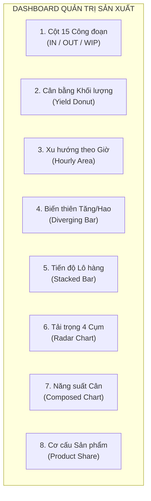

# TÀI LIỆU CẤU TRÚC HỆ THỐNG QUẢN LÝ TRẠM CÂN (PHAN BACH WEIGH DASHBOARD)

Hệ thống quản lý sản xuất, trạm cân công nghiệp và giám sát mẻ cân IoT thời gian thực cho nhà máy chế biến thủy sản Phan Bách. Hệ thống được module hóa chuẩn mực, hỗ trợ chạy linh hoạt trên **PythonAnywhere (WSGI)**, môi trường **Python cục bộ**, hoặc **Node.js / PostgreSQL**.

---

## 1. Cấu Trúc Thư Mục Chuẩn Hóa

```text
webDesignUI/
├── backend/                           # TẦNG MÁY CHỦ DỊCH VỤ (BACKEND)
│   ├── app.py                         # Máy chủ Flask (REST API + Phục vụ SPA React)
│   ├── wsgi.py                        # Entry point chuẩn WSGI cho production
│   ├── pythonanywhere_wsgi.py         # Mẫu cấu hình WSGI dán trực tiếp trên PythonAnywhere
│   ├── config.py                      # Quản lý cấu hình & biến môi trường
│   ├── db.py                          # Kết nối Database thống nhất (PostgreSQL & SQLite)
│   ├── services.py                    # Nghiệp vụ: Quy trình, Trạm cân, Sản phẩm, Mẻ cân, KPI
│   ├── iot_service.py                 # Ingestion dữ liệu mẻ cân từ STM32/Dini Argeo (Debounce)
│   ├── protocol_parser.py             # Bộ giải mã chuỗi ASCII đầu cân Dini Argeo
│   ├── requirements.txt               # Thư viện Python cần thiết (Flask, CORS, psycopg2,...)
│   ├── .env.example                   # Mẫu cấu hình môi trường
│   ├── node/                          # Máy chủ Node.js / TypeScript gốc (kèm TCP socket)
│   │   ├── src/                       # Mã nguồn TypeScript server
│   │   └── dist/                      # Bản build server.cjs
│   └── stm32_firmware_sample/         # Mã nguồn mẫu firmware C cho vi điều khiển STM32
│
├── database/                          # TẦNG CƠ SỞ DỮ LIỆU
│   ├── init_db.sql                    # Schema PostgreSQL chuẩn (bảng, chỉ mục)
│   ├── init_sqlite.sql                # Schema SQLite tối ưu cho PythonAnywhere Free Tier
│   ├── seed_data.py                   # Script Python nạp dữ liệu mẫu cho cả PostgreSQL & SQLite
│   ├── seed_db.cjs                    # Script nạp dữ liệu mẫu gốc (Node.js)
│   └── pmsl_weigh_sample.sql          # Bản xuất dữ liệu mẫu
│
├── src/                               # TẦNG GIAO DIỆN NGƯỜI DÙNG (REACT 18 + TYPESCRIPT)
│   ├── types/                         # Định nghĩa kiểu dữ liệu (station, process, product, log)
│   ├── services/                      # Tầng gọi API kết nối máy chủ (/api/*)
│   ├── components/                    # Linh kiện giao diện tái sử dụng
│   │   ├── layout/                    # Header thanh điều hướng chuẩn nhận diện Phan Bách
│   │   ├── common/                    # StatusBadge, Toast thông báo
│   │   ├── overview/                  # KPI Cards, Sơ đồ dòng chảy 4 cụm, Bảng nhật ký mẻ cân
│   │   ├── stations/                  # Quản lý 27 trạm cân, Sơ đồ Pipeline trạm cân
│   │   └── process/                   # Quản lý 15 công đoạn chế biến & Đồ thị liên kết
│   └── pages/                         # Các màn hình chính (Overview, WeighStation, Process, Product)
│
├── public/                            # TÀI NGUYÊN TĨNH
│   ├── logo.png                       # Logo thương hiệu Phan Bách
│   └── processflow.jpg                # Sơ đồ quy trình công nghệ chuẩn nhà máy
│
├── dist/                              # BẢN BUILD SẴN SÀNG TRIỂN KHAI CỦA FRONTEND
├── legacy/                            # BẢN MẪU TĨNH GỐC ĐÃ ĐƯỢC DỌN DẸP
│   ├── weighStation.html              # Bản HTML mẫu cũ
│   ├── process.html                   # Bản HTML mẫu cũ
│   └── product.html                   # Bản HTML mẫu cũ
│
├── package.json                       # Danh mục scripts và thư viện NPM
├── vite.config.ts                     # Cấu hình Vite bundler & reverse proxy /api
├── tailwind.config.js                 # Cấu hình Tailwind CSS
├── DEPLOYMENT_PYTHONANYWHERE.md       # Hướng dẫn chi tiết từng bước chạy trên PythonAnywhere
└── README.md                          # Tài liệu tổng quan hệ thống
```

---

## 2. Hướng Dẫn Triển Khai & Khởi Chạy

### Cách 1: Triển khai trên PythonAnywhere
Xem toàn bộ hướng dẫn từng bước chi tiết tại:  
👉 **[DEPLOYMENT_PYTHONANYWHERE.md](file:///Users/phanbach/Desktop/TheBaoUser/PhanBachWork/website/weigh_dashboard/webDesignUI/DEPLOYMENT_PYTHONANYWHERE.md)**

Tóm tắt các bước chính:
1. Git clone mã nguồn vào tài khoản PythonAnywhere.
2. Tạo virtualenv và cài đặt: `pip install -r backend/requirements.txt`.
3. Nạp database mẫu: `python3 database/seed_data.py` (tạo ngay file SQLite không cần cài thêm DB).
4. Cấu hình thẻ **Web** với file WSGI theo mẫu `backend/pythonanywhere_wsgi.py`.
5. Nhấn **Reload** và truy cập tên miền `https://<username>.pythonanywhere.com`.

---

### Cách 2: Khởi chạy nhanh cục bộ với Python Backend (Khuyên dùng)
Máy chủ Python Flask tự động phục vụ cả REST API và giao diện tĩnh Vite React:

```bash
# 1. Cài đặt thư viện Python (nếu chưa cài):
pip install -r backend/requirements.txt

# 2. Khởi tạo & nạp dữ liệu mẫu vào SQLite:
python3 database/seed_data.py

# 3. Chạy máy chủ:
python3 backend/app.py
```
Truy cập hệ thống tại: **`http://localhost:5001`**

---

### Cách 3: Chế độ Lập trình viên Frontend (Hot Reload React)
Khi cần chỉnh sửa giao diện giao diện React với Hot Reload tức thì:

```bash
# Terminal 1: Chạy máy chủ Backend API (cổng 5001)
npm run server

# Terminal 2: Chạy Vite Development Server (cổng 3000)
npm run dev
```
Truy cập giao diện tại: **`http://localhost:3000`** (Vite tự động chuyển tiếp các yêu cầu `/api/*` sang cổng 5001).

---

### Cách 4: Chạy với Node.js Backend & PostgreSQL (Tùy chọn)
Nếu bạn muốn sử dụng Node.js backend và mở cổng TCP socket cho trạm cân thực tế:

```bash
# 1. Khởi tạo cơ sở dữ liệu PostgreSQL
npm run db:init
npm run db:seed

# 2. Build và khởi chạy Node.js Server
npm run server:node:build
npm run server:node
```

---

## 3. Danh Mục Các Điểm Cuối REST API

| Phương thức | Đường dẫn | Chức năng |
| :--- | :--- | :--- |
| `GET` | `/api/health` | Kiểm tra tình trạng kết nối DB & số lô hoạt động |
| `GET` | `/api/processes` | Lấy danh sách 15 công đoạn & 17 liên kết luồng |
| `POST` | `/api/processes` | Thêm mới / cập nhật công đoạn |
| `DELETE` | `/api/processes/:id` | Xóa công đoạn |
| `GET` | `/api/stations` | Lấy danh sách 27 trạm cân công nghiệp |
| `POST` | `/api/stations` | Thêm mới trạm cân |
| `PUT` | `/api/stations/:id` | Cập nhật thông số trạm cân |
| `DELETE` | `/api/stations/:id` | Xóa trạm cân |
| `GET` | `/api/products` | Lấy danh mục quy cách sản phẩm theo khâu |
| `GET` | `/api/logs` | Lấy lịch sử mẻ cân (lọc theo `batch_id`) |
| `POST` | `/api/logs` | Ghi nhận mẻ cân thủ công từ giao diện |
| `DELETE` | `/api/logs/:id` | Xóa bản ghi mẻ cân |
| `GET` | `/api/metrics` | Lấy 4 chỉ số KPI chính (IN, WiP, OUT, Yield %) |
| `GET` | `/api/batches` | Lấy danh sách mã lô sản xuất |
| `POST` | `/api/iot/weigh` | Tiếp nhận mẻ cân tự động từ chip STM32 / Loadcell |

---

## 4. Hướng Dẫn Thuyết Minh Chi Tiết: Ý Nghĩa & Cách Vẽ Hệ Thống Biểu Đồ

> [!NOTE]
> **Triết lý cốt lõi của ngành chế biến thủy sản (Chế biến tôm Phan Bách):**  
> Khác với các ngành lắp ráp cơ khí (vật tư 1 + 1 = 2), ngành thủy sản vừa có **Hao hụt tự nhiên** (bóc vỏ, lặt đầu, luộc rút nước) vừa có **Tăng trọng công nghệ** (ngâm quay phụ gia giữ ẩm, lăn bột chiên xù).  
> Hệ thống biểu đồ trên Dashboard được thiết kế chuẩn mực theo nguyên lý **Cân bằng vật chất (Mass Balance)**, giúp Ban điều hành trả lời tức thì 3 câu hỏi sống còn:
> 1. *Nguyên liệu nhập vào đang nằm ở đâu trong nhà máy?*
> 2. *Tỷ lệ thu hồi (Yield) và hao hụt từng công đoạn có nằm trong định mức kỹ thuật không?*
> 3. *Dây chuyền đang bị nghẽn (Bottleneck) ở khâu nào để kịp thời điều động nhân công?*

---

### 4.0. Kiến Trúc Tính Toán Động: Giải Quyết Bài Toán Thêm / Xoá Công Đoạn

> [!IMPORTANT]
> **CÂU HỎI KIẾN TRÚC HỆ THỐNG:**  
> *"Nếu mã nguồn fix cứng tên công đoạn (như CD001, CD004, CD005...), thì sau này người dùng tự thêm công đoạn mới hoặc xóa công đoạn đi thì công thức có bị sai không? Làm sao để tính IN, OUT và WIP chính xác tuyệt đối mà không phụ thuộc vào công đoạn cố định?"*

#### 1. Nguyên lý Tự Động Nhận Diện Đầu Vào (IN) & Đầu Ra (OUT) qua Đồ Thị Luồng (Graph Topology)
Thay vì gán cứng `CD001` là đầu vào và `CD015` là đầu ra, hệ thống điều hướng dựa trên bảng liên kết luồng `process_mapping` (`from_process_id` $\rightarrow$ `to_process_id`):
- **Công đoạn Đầu Vào Gốc (Raw IN):** Là công đoạn **không có luồng nào trỏ vào nó** (Nút gốc / In-degree = 0 trong đồ thị). Khi nhà máy đổi quy trình hoặc thêm khâu tiếp nhận mới, hệ thống tự động nhận diện đây là nguồn cấp nguyên liệu.
- **Công đoạn Đầu Ra Thành Phẩm (Finished OUT):** Là các công đoạn **không trỏ tiếp đi đâu nữa** (Nút lá / Out-degree = 0 trong đồ thị). Bất kể có 1 hay 5 công đoạn đóng gói/cấp đông, tổng xuất ra ở các nút lá này chính là Thành Phẩm.

#### 2. Bản Chất Chuẩn Xác của WIP (Work In Progress): Tính Theo Vòng Đời Mẻ Cân (Batch State Tracking)
Để không bao giờ bị sai lệch khi công đoạn là **Tăng trọng** (10kg vào $\rightarrow$ 10.5kg ra) hay **Hao hụt** (10kg vào $\rightarrow$ 6kg ra), hoặc khi **Thêm/Xoá công đoạn**:

$$\mathbf{\text{WIP tại công đoạn } X = \sum \Big(\text{Khối lượng các mẻ ĐÃ CÂN IN nhưng CHƯA CÂN OUT}\Big)}$$

- **Khi tôm được đưa vào công đoạn:** Mẻ cân được tạo với trạng thái `ĐANG THỰC HIỆN` $\rightarrow$ Khối lượng nguyên liệu của mẻ đó được tính là **WIP (Đang xử lý)**.
- **Khi công nhân/thiết bị làm xong và cân xuất đi:** Trạng thái mẻ đó chuyển sang `HOÀN THÀNH` $\rightarrow$ **WIP tại công đoạn đó tự động trở về 0**, và chuyển tiếp thành WIP của công đoạn kế tiếp.
- **Tại sao cách tính này chính xác 100% trong mọi trường hợp?**
  1. *Không phụ thuộc tăng/giảm kg:* Chừng nào mẻ tôm còn đang nằm trong máy ngâm hoặc trên bàn bóc vỏ thì nó là WIP; khi đã cân ra chuyển bước khác thì WIP tại bàn đó bằng 0.
  2. *Độc lập với quy trình:* Người dùng tự thêm 10 công đoạn hay xóa bớt 5 công đoạn thì mỗi trạm cân chỉ việc theo dõi: *"Có bao nhiêu mẻ đã nhận vào mà chưa thấy dập cân chuyển đi"*.

---

### Bảng Tổng Hợp 8 Biểu Đồ Trực Quan



---

### Chi Tiết Từng Biểu Đồ & Mẫu Lời Thoại Thuyết Trình

#### 1. Biểu Đồ Cột 15 Công Đoạn (15 Stages Bar Chart: Vào / Ra / Đọng)
- **Loại biểu đồ:** Bar Chart (3 cột nhóm).
- **Ý nghĩa & Thể hiện:**  
  Giám sát dòng chảy khối lượng đi qua từng công đoạn trong toàn bộ 15 bước của nhà máy (từ `CD001 - Tiếp nhận nguyên liệu` đến `CD015 - Cấp đông IQF tôm chín`).
  - **Cột Xanh dương (Vào - IN):** Tổng khối lượng nguyên liệu/bán thành phẩm nhận vào trạm cân của công đoạn đó.
  - **Cột Xanh lục (Ra - OUT):** Tổng khối lượng bán thành phẩm đã xử lý xong và xuất ra khỏi công đoạn.
  - **Cột Cam hổ phách (Đọng - WIP):** Lượng hàng đang còn nằm dở dang trên bàn chế biến, chưa làm xong.

> [!IMPORTANT]
> **VẤN ĐỀ CỐT LÕI: "Nếu khâu Ngâm quay vào 10kg mà ra 10.5kg (do tăng trọng), hoặc khâu Bóc vỏ vào 10kg ra 6kg thịt (do bỏ vỏ), thì làm sao tính chính xác WIP khi lấy IN - OUT?"**
>
> ❌ **Nếu trừ cơ học ngây thơ ($\text{WIP} = \text{IN} - \text{OUT}$):**  
> - Tại khâu ngâm quay: $10 - 10.5 = -0.5 \text{ kg}$ (Vô lý vì hàng đọng thực tế không bao giờ có khối lượng âm).
> - Tại khâu bóc vỏ: $10 - 6 = 4 \text{ kg}$ (Sai bản chất, vì 4kg đó là **vỏ tôm đã đổ vào thùng rác**, không phải 4kg thịt tôm đang còn đọng trên bàn chế biến).
>
> ✅ **Thuật toán xử lý chuẩn hóa của hệ thống (trong file `src/services/logService.ts`):**  
> Hệ thống phân loại 15 công đoạn thành 4 nhóm đặc thù vật lý riêng biệt:
> 1. **Nhóm Tăng trọng (`CD005 Ngâm quay`, `CD007 Tẩm bột`):** Khi $\text{OUT} > \text{IN}$, mẻ đã xuất xong ra khỏi cối thì $\text{WIP} = 0$. Khoản chênh lệch $+0.5\text{ kg}$ được chuyển vào chỉ số **Khối lượng tăng trọng (Gain Weight)** của Biểu đồ 4, tuyệt đối **không làm âm WIP**.
> 2. **Nhóm Hao hụt vỏ (`CD004 Bóc vỏ`, `CD011 Tách vỏ`):** Hệ thống đối chiếu với hệ số định mức thu hồi thịt chuẩn ($K \approx 58\% - 65\%$). Khi lượng thịt ra đạt chuẩn định mức, hệ thống hiểu mẻ đã hoàn tất: $\text{WIP} = 0$, phần $4\text{ kg}$ thiếu được chuyển vào chỉ số **Hao hụt sơ chế (Peel Loss)**. Chỉ khi lượng thịt ra thấp bất thường (ví dụ mới ra $20\%$, tức công nhân đang bóc dở dang trên bàn), phần chênh lệch chưa bóc xong mới được ghi nhận vào $\text{WIP}$.
> 3. **Công thức tổng quát theo Hệ số Chuyển đổi ($K_{\text{định mức}}$):**
>    $$\text{WIP}_{\text{thực tế}} = \max\left(0, \text{IN} - \frac{\text{OUT}}{K_{\text{định mức}}}\right)$$
>    *(Với $K > 1$ cho khâu ngâm/tẩm bột; $K < 1$ cho khâu bóc vỏ; $K = 1$ cho khâu chuyển giao bảo toàn).*

- **Cách nói khi thuyết minh (Nếu bị hỏi vặn câu này):**  
  > *"Câu hỏi rất hay! Nếu lấy IN trừ OUT một cách máy móc thì khâu ngâm quay sẽ bị âm hàng đọng (-0.5kg), còn khâu bóc vỏ sẽ nhầm vỏ tôm vứt đi thành hàng tồn kho. Hệ thống của chúng tôi đã xử lý bằng thuật toán phân loại công đoạn: Khâu tăng trọng khi xả mẻ thì WIP = 0 và ghi nhận số tăng trọng vào báo cáo riêng; còn khâu bóc vỏ thì đối chiếu định mức thu hồi 60% để bóc tách chính xác đâu là vỏ tôm đã thải loại, đâu là tôm thịt thực sự còn đang đọng dở dang trên bàn."*

---

#### 2. Biểu Đồ Cân Bằng Khối Lượng & Thu Hồi (Mass Balance Donut Chart)
- **Loại biểu đồ:** Donut Chart (Vành khuyên tròn) kèm số hiển thị trung tâm.
- **Ý nghĩa & Thể hiện:**  
  Minh họa **Định luật bảo toàn khối lượng**: 100% nguyên liệu mua vào của một lô/ngày làm việc đã được phân bổ thành những gì?
  - **Phần Xanh lục (Thành phẩm OUT):** Khối lượng đã cấp đông và đóng gói thành phẩm sẵn sàng xuất bán.
  - **Phần Vàng cam (Đang đọng WIP):** Khối lượng bán thành phẩm còn nằm dở dang trong các xưởng.
  - **Phần Xám bạc (Hao hụt sơ chế Loss):** Phần khối lượng mất đi hợp lệ (vỏ tôm, đầu tôm, mất nước tự nhiên khi luộc/cấp đông).
  - **Con số lớn ở giữa:** **Tỷ lệ thu hồi (Yield Rate %)** của toàn bộ quá trình.
- **Cách tính & Cách vẽ:**  
  - $\text{Tổng IN} = \sum \text{net\_weight}$ nhập tại công đoạn gốc `CD001`.
  - $\text{Tổng OUT} = \sum \text{net\_weight}$ xuất tại các công đoạn cuối (`CD012 - CD015`).
  - $\text{Hao hụt (Loss)} = \max(0, \text{Tổng IN} - \text{Tổng OUT} - \text{WIP})$.
  - $\text{Yield Rate (\%)} = \left(\frac{\text{Tổng OUT}}{\text{Tổng IN}}\right) \times 100\%$.
- **Cách nói khi thuyết minh:**  
  > *"Biểu đồ này trả lời câu hỏi lớn nhất của Giám đốc tài chính: Mua 10 tấn tôm nguyên liệu vào, cuối cùng ta thu được bao nhiêu tấn thành phẩm? Con số ở giữa **74.5%** chính là tỷ lệ thu hồi thực tế. Phần màu xanh lục là thành phẩm đã vô kho, màu cam là hàng đang làm dở, và màu xám là phần vỏ tôm/đầu tôm bị hao hụt trong quá trình sơ chế."*

---

#### 3. Biểu Đồ Xu Hướng Sản Lượng Theo Khung Giờ (Hourly Production Area Chart)
- **Loại biểu đồ:** Spline Area Chart (Biểu đồ miền phủ dải màu).
- **Ý nghĩa & Thể hiện:**  
  Đo lường nhịp độ vận hành của xưởng trong ngày từ ca sáng (07:00) đến ca tối (19:00).
  - **Dải Xanh dương:** Nhịp độ tiếp nhận nguyên liệu vào chuyền.
  - **Dải Xanh lá:** Nhịp độ đóng gói thành phẩm xuất kho.
- **Cách tính & Cách vẽ:**  
  - Lấy trường thời gian `time_action` của từng mẻ cân, gom nhóm theo các mốc 2 giờ (`07:00`, `09:00`, `11:00`, `13:00`, `15:00`, `17:00`, `19:00`).
  - Tính tổng sản lượng IN và OUT của từng khung giờ và vẽ đường dải màu chuyển sắc (gradient).
- **Cách nói khi thuyết minh:**  
  > *"Biểu đồ này phản ánh nhịp sinh học của nhà máy. Ta thấy đỉnh cao nhất của dải xanh dương (nhập hàng) rơi vào 07:00 - 09:00 sáng khi xe tôm về; chững lại vào giờ trưa (11:00 - 13:00); và dải xanh lá (thành phẩm) bắt đầu tăng vọt từ 15:00 - 17:00 khi các mẻ cấp đông hoàn tất ra hàng."*

---

#### 4. Biểu Đồ Biến Thiên: Tăng Trọng (+) & Hao Hụt (-) (Diverging Bar Chart)
- **Loại biểu đồ:** Diverging Bar Chart (Cột phân kỳ đối xứng qua trục số 0).
- **Ý nghĩa & Thể hiện:**  
  **Đây là biểu đồ đặc thù và giá trị nhất cho chế biến tôm.** Nó giúp minh bạch việc thay đổi khối lượng của sản phẩm tại từng công đoạn:
  - **Cột Xanh lá mọc lên trên (+):** Các công đoạn **Tăng trọng** (như `CD005 - Ngâm quay tôm` ngậm nước phụ gia, `CD007 - Tẩm bột chiên xù` bám bột).
  - **Cột Đỏ đâm xuống dưới (-):** Các công đoạn **Hao hụt** (như `CD004 - Bóc vỏ rút chỉ`, `CD009/CD010 - Luộc/hấp` làm rút nước, `CD011 - Tách vỏ sau luộc`).
- **Cách tính & Cách vẽ:**  
  - Với mỗi công đoạn: $\Delta = \text{OUT} - \text{IN}$.
  - Nếu $\Delta \ge 0$: Vẽ cột màu xanh lá hướng lên với giá trị $+\Delta \text{ kg}$.
  - Nếu $\Delta < 0$: Vẽ cột màu đỏ hồng hướng xuống với giá trị $-|\Delta| \text{ kg}$.
- **Cách nói khi thuyết minh:**  
  > *"Điểm hay của hệ thống cân Phan Bách là giải quyết được bài toán Tăng trọng - Hao hụt. Cột xanh lá tại CD005 cho thấy mẻ tôm sau khi ngâm quay phụ gia đã tăng thêm +18.5 kg (+8.2%), và CD007 tẩm bột tăng thêm +35 kg. Ngược lại, cột đỏ tại CD004 cho thấy khâu bóc vỏ làm giảm -42 kg do đã loại bỏ vỏ tôm. Nhờ biểu đồ này, kiểm toán kỹ thuật thấy ngay tỷ lệ tăng trọng và hao hụt có tuân thủ đúng tiêu chuẩn xuất khẩu không."*

---

#### 5. Biểu Đồ So Sánh Tiến Độ Các Lô Hàng (Batch Progress Stacked Bar)
- **Loại biểu đồ:** Horizontal Stacked Bar (Cột ngang xếp chồng).
- **Ý nghĩa & Thể hiện:**  
  Giám sát trạng thái sản xuất đa lô trong cùng một ngày (`L0001`, `L0002`, `L0003`,...).
  - **Xanh lục:** Khối lượng thành phẩm đã đóng gói (OUT).
  - **Vàng cam:** Khối lượng đang nằm trên chuyền sản xuất (WIP).
  - **Xám nhạt:** Khối lượng nguyên liệu còn lại chưa đưa vào sản xuất so với kế hoạch ban đầu (Remaining).
- **Cách tính & Cách vẽ:**  
  - Gom nhóm các mẻ cân theo `batch_id`.
  - $\text{Thành phẩm} = \sum \text{net\_weight}$ khâu cuối của Lô.
  - $\text{Đang làm} = \sum \text{WIP}$ của Lô trên tất cả công đoạn.
  - $\text{Còn lại} = \max(0, \text{Kế hoạch Lô} - \text{Tổng IN đã nhận})$.
- **Cách nói khi thuyết minh:**  
  > *"Thay vì xem báo cáo giấy cuối ngày, người quản lý nhìn biểu đồ này là biết ngay Lô L0001 đã làm xong 90% (toàn thanh xanh lục), sẵn sàng đóng container xuất khẩu; trong khi Lô L0003 mới nạp nguyên liệu được 30%, phần màu xám còn nhiều."*

---

#### 6. Biểu Đồ Radar Tải Trọng 4 Cụm Nhà Máy (Cluster Radar Chart)
- **Loại biểu đồ:** Radar Chart (Biểu đồ mạng nhện 4 cực).
- **Ý nghĩa & Thể hiện:**  
  Đo lường mức độ cân đối khối lượng tải trọng giữa 4 khu vực phân xưởng thực tế:
  - **Cụm 1 - Tiếp nhận & Sơ chế:** CD001 $\rightarrow$ CD004 (Khu bẩn/ướt).
  - **Cụm 2 - Ngâm quay phụ gia:** CD005 $\rightarrow$ CD007 (Khu xử lý hóa sinh).
  - **Cụm 3 - Chế biến nhiệt:** CD008 $\rightarrow$ CD011 (Khu luộc/chiên).
  - **Cụm 4 - Cấp đông & Đóng gói:** CD012 $\rightarrow$ CD015 (Khu lạnh/phòng sạch).
- **Cách tính & Cách vẽ:**  
  - Tính tổng tải trọng luân chuyển của từng cụm: $\text{Tải trọng cụm} = \sum (\text{IN} + \text{OUT})$ của các công đoạn thuộc cụm đó.
  - Chuẩn hóa trên 4 trục tọa độ cực từ tâm ra biên.
- **Cách nói khi thuyết minh:**  
  > *"Biểu đồ mạng nhện cho thấy mức độ chịu tải của 4 cụm phân xưởng. Nếu mạng nhện phình to lệch hẳn về Cụm 1, nghĩa là lượng tôm thô tiếp nhận đang quá tải. Khi mạng nhện chuyển dịch đều sang Cụm 4, chứng tỏ toàn bộ khối lượng sản xuất đang đổ dồn về khâu bao gói cuối chuyền."*

---

#### 7. Biểu Đồ Năng Suất & Tần Suất Cân (Composed Bar & Line Chart)
- **Loại biểu đồ:** Composed Chart (Cột kết hợp Đường với 2 trục tung Y độc lập).
- **Ý nghĩa & Thể hiện:**  
  Đo lường cường độ làm việc của công nhân và tính chuẩn hóa của các mẻ cân IoT:
  - **Cột Xanh Cyan (Trục Y trái):** Số lần dập cân thực hiện trong khung giờ (Tần suất thao tác).
  - **Đường Cam (Trục Y phải):** Trọng lượng trung bình của một mẻ cân ($\text{kg/mẻ}$).
- **Cách tính & Cách vẽ:**  
  - $\text{Số mẻ} = \text{COUNT}(\text{mẻ cân})$ trong khung giờ.
  - $\text{Kg / mẻ} = \frac{\sum \text{net\_weight}}{\text{Số mẻ}}$.
- **Cách nói khi thuyết minh:**  
  > *"Biểu đồ kết hợp này giúp kiểm soát kỷ luật sản xuất: Cột xanh đo nhịp độ công nhân dập cân trên bàn cân Dini Argeo/STM32; còn đường màu cam kiểm tra xem công nhân có cân đúng quy cách khay không (ví dụ định mức chuẩn 20 - 25 kg/khay). Nếu đường cam vọt lên quá cao nghĩa là có hiện tượng dồn hàng cân ẩu một lần gây sai số."*

---

#### 8. Biểu Đồ Cơ Cấu Sản Phẩm (Product Share Donut Chart)
- **Loại biểu đồ:** Donut Pie Chart (Vành khuyên danh mục sản phẩm).
- **Ý nghĩa & Thể hiện:**  
  Cung cấp cơ cấu tỷ trọng sản lượng theo các mặt hàng xuất khẩu chủ lực (Tôm thẻ vỏ HLSO, Tôm thẻ bóc nõn thịt PD, Tôm Nobashi xẻ bướm, Tôm chiên xù tẩm bột, v.v.).
- **Cách tính & Cách vẽ:**  
  - Gom nhóm `net_weight` theo `product_id`.
  - Sắp xếp từ cao xuống thấp và lấy Top các sản phẩm lớn nhất, hiển thị kèm chú giải mã và tên sản phẩm.
- **Cách nói khi thuyết minh:**  
  > *"Biểu đồ này giúp phòng kinh doanh nắm bắt sản lượng hôm nay đang tập trung đóng cho đơn hàng nào nhiều nhất, cơ cấu các dòng sản phẩm GTGT (giá trị gia tăng) như tẩm bột chiên hay tôm tươi cấp đông chiếm bao nhiêu phần trăm."*

---

### Tóm Tắt 4 Thẻ Chỉ Số KPI Phía Trên (Header KPI Cards)

Ngoài 8 biểu đồ chi tiết, thanh tóm tắt đầu trang luôn hiển thị 4 số liệu cô đọng nhất:
1. **Vào (IN):** Tổng khối lượng nguyên liệu thô nhập vào tại khâu đầu tiên và số mẻ cân tiếp nhận.
2. **Ra (OUT) & Yield %:** Tổng thành phẩm đã đóng gói hoàn thành và tỷ lệ thu hồi tổng xưởng.
3. **Đọng (WIP):** Khối lượng hàng dở dang đang nằm trên dây chuyền và số lượng công đoạn đang phát sinh nghẽn.
4. **Chưa làm (Remaining):** Khối lượng nguyên liệu còn thiếu cần tiếp tục thu mua/nhập kho để hoàn tất kế hoạch lô.
5. **Thanh tỷ lệ Mini Bar:** Dải màu liên tục thể hiện tỷ trọng trực quan: **% Thành phẩm (Xanh lục)** : **% Đọng WIP (Cam)** : **% Hao hụt (Xám)**.
